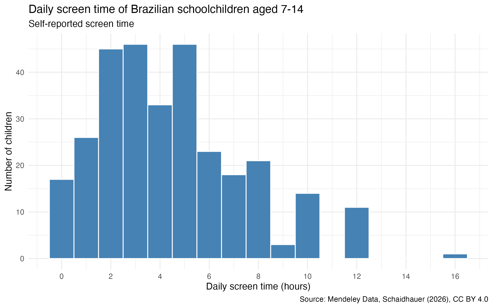
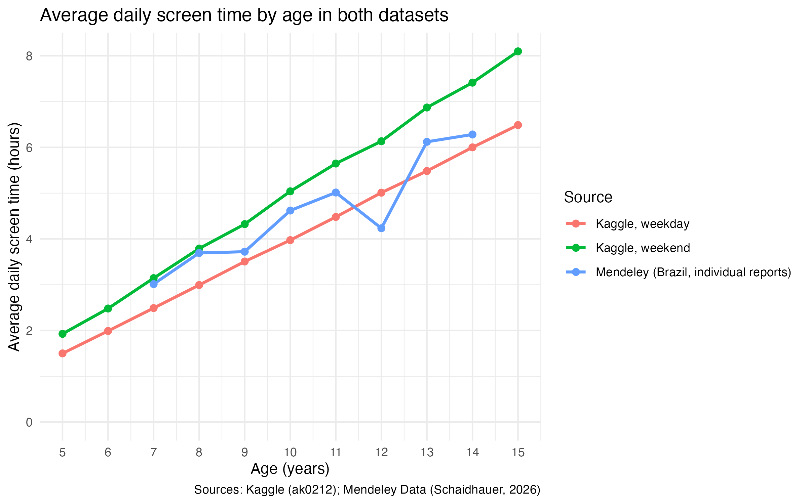

# Data Dictionary

This dictionary describes the two cleaned files created by `R/Screen Time Research Project.R`. Both files are in `data/clean/`. The raw files in `data/raw/` are unchanged.

---

## 1. `data/clean/kaggle_screen_time_total.csv`

**Source:** Kaggle, *Average Daily Screen Time for Children* (uploader ak0212). Raw file: `data/raw/screen_time.csv`.

| Variable | Description | Type | Units | Permitted values | Missing values | Source |
|----------|-------------|------|-------|------------------|----------------|--------|
| `age`    | Age of the children in the group. Renamed from `Age`. | Numeric (whole number) | Years | 5 to 15 | None | Kaggle (ak0212) |
| `gender` | Gender category of the children in the group. Renamed from `Gender`. | Character | None | "Male", "Female", "Other/Prefer not to say" | None | Kaggle (ak0212) |
| `screen_type` | Kind of screen time the average describes. After cleaning, it is always "Total" (educational plus recreational), so this column does not vary. Renamed from `Screen Time Type`. | Character | None | "Total" only | None | Kaggle (ak0212) |
| `day_type` | Whether the average describes school-week days or weekend days. Renamed from `Day Type`. | Character | None | "Weekday", "Weekend" | None | Kaggle (ak0212) |
| `avg_hours` | Average daily total screen time of the group on that type of day. Renamed from `Average Screen Time (hours)`. | Numeric | Hours per day | Observed range 1.45 to 8.19 | None | Kaggle (ak0212) |
| `sample_size` | Number of children that the average appears to be based on (the source does not define this column; this is taken from its name). Used as the weight when averaging across groups. Renamed from `Sample Size`. | Numeric (whole number) | Number of children | Observed range 300 to 500 | None | Kaggle (ak0212) |

---

## 2. `data/clean/mendeley_screen_time.csv`

**Source:** Mendeley Data, Schaidhauer, F. (2026), *Screen time, social media use, physical activity and depressive symptoms (CDI) in Brazilian schoolchildren (n = 320)*, version 2. Raw file: `data/raw/dataset_depressao_infantil_public.csv`. Licence: CC BY 4.0.

| Variable | Description | Type | Units | Permitted values | Missing values | Source |
|----------|-------------|------|-------|------------------|----------------|--------|
| `study_id` | Number the original study assigned to each child. It identifies a row only and does not reveal who the child is. | Numeric (whole number) | None | 1 to 320 (310 values remain after cleaning) | None | Mendeley |
| `age_years` | Age of the child at the time of the survey. | Numeric (whole number) | Years | 7 to 16 observed. Only 6 children are 15 or 16, and the analysis uses 7 to 14. | None | Mendeley |
| `screen_time_minutes_per_day` | Child's reported daily screen time, as given in the raw data. Values are mostly round numbers (60, 120, 180), which suggests self-reported estimates. | Numeric | Minutes per day | 0 to 960 observed. Includes 0 minutes and values of 12 hours or more, which are kept but may be unreliable. | None after cleaning (rows with missing values were dropped) | Mendeley |
| `screen_hours` | **Derived.** `screen_time_minutes_per_day` divided by 60, so it matches the hours used in the Kaggle data. | Numeric | Hours per day | 0 to 16 | None | Derived from `screen_time_minutes_per_day` |
| `social_media_use_binary` | Whether the child uses social media. | Numeric (0/1) | None | 0 = does not use social media, 1 = uses social media | `NA` for 3 children, who did not answer. They are left out of the social media comparison only. | Mendeley |
| `household_arrangement` | Who the child lives with, as a category code in Portuguese from the original data. | Character | None | "pai_e_ou_mae" (father and/or mother), "mae_e_padrasto" (mother and stepfather), "outros_familiares" (other relatives). English meanings are my translation. | `NA` for 5 children, who did not answer. They are left out of the household comparison only. | Mendeley |

---

## Figures

Both figures are created by `R/Screen Time Research Project.R` and saved in `figures/`. They use only the cleaned variables described above.

### `figures/screen_time_histogram.png`

- **What it shows:** How many children reported each amount of daily screen time.
- **Data used:** `data/clean/mendeley_screen_time.csv`, children aged 7 to 14 only (304 children).
- **Variables:** The x-axis is `screen_hours` (hours per day). The y-axis is a count of children.
- **How it is built:** Each bar is one hour wide and centred on a whole hour, so the bar labelled 3 covers 2.5 to 3.5 hours.
- **What it shows in the data:** Most children report between 2 and 6 hours. The tallest bars (about 46 children each) are at 3 and 5 hours, and the distribution has a long tail to the right. A few children report 10 or 12 hours, and one reports 16.
- **Limits:** Screen time is self-reported and often rounded (many answers are whole hours), which explains the uneven bars. The very high values were kept and may be unreliable.

### `figures/screen_time_by_age.png`

- **What it shows:** Average daily screen time at each age, drawn as three separate lines so the two sources can be compared.
- **Data used:** `data/clean/kaggle_screen_time_total.csv` (two lines, one for weekdays and one for weekends, ages 5 to 15) and `data/clean/mendeley_screen_time.csv` (one line, ages 7 to 14).
- **Variables:** The x-axis is `age` (Kaggle) or `age_years` (Mendeley), in years. The y-axis is the average daily screen time in hours. For Kaggle it is `avg_hours` averaged across genders and weighted by `sample_size`. For Mendeley it is the mean of `screen_hours` for all children of that age.
- **How it is built:** The three summaries are stacked into one table with a `series` label (which source and day type) and plotted together. The y-axis starts at 0 so the slope is not exaggerated.
- **What it shows in the data:** All three lines rise with age. The Kaggle lines rise smoothly and weekends are higher than weekdays at every age. The Mendeley line is less regular, with a dip at age 12 and a jump at age 13.
- **Limits:** The sources are not merged at the child level and describe different populations, so the lines show similar direction, not the same measure. The Mendeley line is based on 30 to 53 children per age, so single ages are noisy. Kaggle's origin is unknown and the data may be simulated. Neither dataset follows the same children over time.

